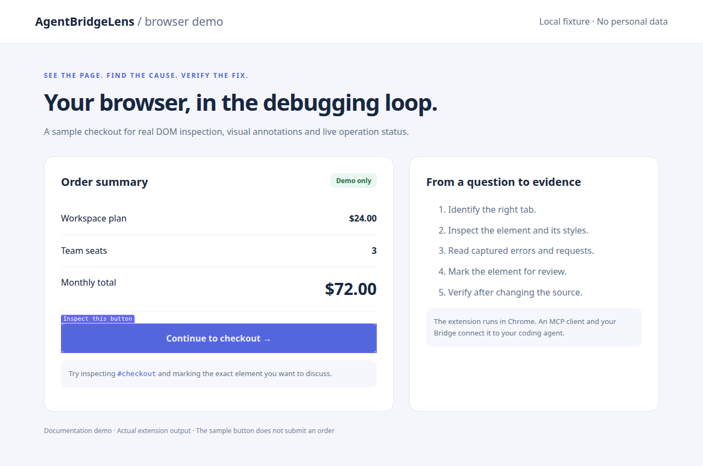
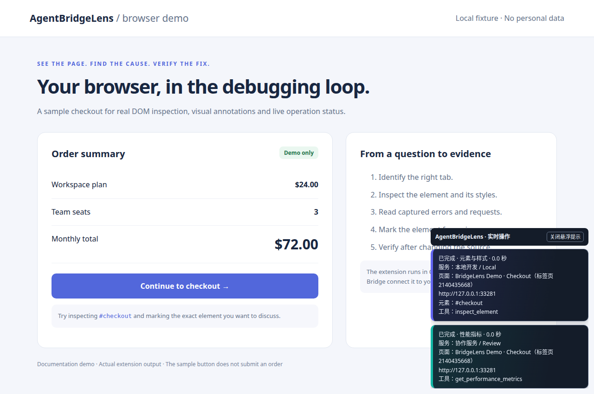
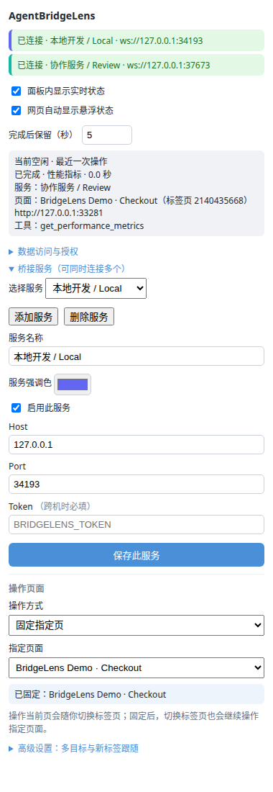

<div align="center">


# AgentBridgeLens

**Give your AI a view into your real Chrome. Trace page problems back to code.**

Keep your current login and page state. Use MCP to capture screenshots, inspect elements, read errors and requests, then verify fixes in the browser.

[简体中文](README.md) · **English**

[](https://github.com/Erhao/AgentBridgeLens/releases/latest)
[](https://www.npmjs.com/package/agentbridgelens)
[](packages/extension/src/manifest.json)
[](packages/bridge/README.md)

[📦 Download](https://github.com/Erhao/AgentBridgeLens/releases/latest) · [🚀 Quick start](#-quick-start) · [🧰 MCP tools](#-mcp-tools) · [📖 User guide (中文)](docs/USAGE.md)

</div>



*Actual extension output: visual annotations identify the exact button under discussion. Screenshots use a local demo page in an isolated browser profile, with no personal browsing data.*

## ✨ Why AgentBridgeLens

- **Keep the problem in place.** Connect to Chrome with your existing login, page content and interaction state, without signing in again to reproduce it.
- **Move from symptoms to source.** Combine screenshots, DOM, computed styles, console and network records. Trace React/Vue components in development builds and resolve error stacks when source maps are available.
- **See what the AI is doing.** On-page activity cards show the tool, target tab, Bridge, data category, outcome and duration. Panel status and page notifications have independent switches.
- **Keep inspecting while you switch tabs.** Pin a target or pass explicit `tabId` values for multiple pages, including background DOM inspection, network capture and screenshots.
- **Connect one Chrome to multiple Bridges.** Local machines and remote services connect concurrently, reconnect independently and use customizable colors to identify their activity.
- **Fit your MCP workflow.** Use stdio or Streamable HTTP. Run the Bridge with `npx` and download a prebuilt extension.

Useful for frontend debugging, diagnosing authenticated business applications, inspecting flows across tabs and verifying source changes with a human in the loop. Your AI coding client edits the project source; the extension provides browser evidence and page operations.

## 👀 See how it works

### Describe the problem and inspect the real page

Ask your AI:

> The submit button on this page does nothing. Confirm the target page, inspect the button and recent errors, and start network capture if needed before I reproduce it. Find the cause in the source and verify the fix afterward.

A typical investigation:

```text
Identify the tab → Screenshot / inspect the button → Read errors and requests
                 → Trace component or error source → Edit code → Verify in Chrome
```

| Goal | Example prompt |
| --- | --- |
| Debug layout | “The right card is clipped. Check its width and overflow, and mark the relevant elements.” |
| Investigate an API | “The list stays empty. Start network capture; I’ll refresh so you can inspect status and timing.” |
| Find source code | “Which React/Vue component renders this button? Which CSS rule sets its color?” |
| Reproduce a sequence | “Start recording while I reproduce it. Stop, fix the problem, then replay those actions.” |
| Inspect two tabs | “Pin these two pages and inspect the original and newly opened page using their tabIds.” |
| Choose together | “Offer two options in the extension side panel and wait for my selection.” |

### Follow activity directly on the page



Each call gets its own card, stacked in start order. Running calls stay visible; finished calls remain for **2 seconds** by default, adjustable from **0 to 300 seconds**. Customize each Bridge’s accent color without interrupting connections. Tool screenshots automatically hide activity cards.

*This screenshot shows actual extension output from scripted tool requests through two local demo Bridges. Completed-card retention was increased for readability.*

### Control connections and target pages

<p align="center">
  
</p>

Both the popup and side panel manage connections, consent and target tabs. The default is “操作当前页” (follow the active page). Choose “固定指定页” to pin a specific page; advanced settings contain multiple targets and new-tab following.

> The extension UI is currently primarily Chinese; this README explains the corresponding controls in English. Screenshots use temporary demo ports; the actual default WebSocket port is `19222`.

## 🚀 Quick start

You need **Chrome, an MCP-capable AI client, and Node.js 18+ to run the Bridge**. Installing the extension alone does not require Node.js. The optional updater requires Node.js 20+ and system `curl`.

### 1. Download and load the extension

1. Download `agentbridgelens-extension-X.Y.Z.zip` from [GitHub Releases](https://github.com/Erhao/AgentBridgeLens/releases/latest).
2. Extract it into a directory you intend to keep.
3. Open `chrome://extensions/` and enable **Developer mode**.
4. Click **Load unpacked** and select the extracted directory containing `manifest.json`.

### 2. Configure MCP in your AI client

For Claude Code, register at user scope to make the service available across projects:

```bash
claude mcp add -s user bridgelens -- npx -y agentbridgelens
```

For other MCP stdio clients, adapt this service definition to the client’s configuration format:

```json
{
  "mcpServers": {
    "bridgelens": {
      "command": "npx",
      "args": ["-y", "agentbridgelens"]
    }
  }
}
```

Restart the client or reload its MCP connection. The client starts the Bridge automatically; no separate terminal process is needed.

### 3. Authorize and connect

1. Click AgentBridgeLens in the Chrome toolbar.
2. Expand **“数据访问与授权”** (data access and consent), read the notice, check the consent box and click **“应用授权设置”** (apply). **A new installation will not connect until consent is applied.**
3. Under **“桥接服务”** (Bridges), check Host `127.0.0.1`, Port `19222`, and that the service is enabled. Save changes with **“保存此服务”**.
4. Once the status shows **“已连接”** (connected), open your target HTTP/HTTPS page. Content scripts on already-open ordinary webpages recover automatically after installation, updates or extension reloads; refresh only if recovery fails.
5. Ask your AI: **“Use bridgelens to confirm the current page and capture a screenshot.”**

## 🔌 Multiple tabs, multiple Bridges and remote access

### Pin the target while you switch tabs

Under **“操作页面”** (target page), choose **“固定指定页”** and select the page. The AI can also discover pages with `list_tabs` and pin them with `set_target_tab`.

Target precedence is **explicit `tabId` → pinned target → active tab**. With multiple pinned tabs, the last recorded active tab is used if it belongs to the target set; otherwise the last added target is used. Pinned targets last for the browser session and clear when the browser restarts.

Advanced settings support multiple targets and **“跟随新标签”** (follow new tabs), which adds tabs opened by a target to the target set. Use explicit `tabId` values for ongoing investigations and multi-client coordination.

### Connect one Chrome to multiple services

Under Bridges, click **“添加服务”** (add service). Set a name, Host, Port and Token, enable the service and save. Each connection reconnects independently, and results return only to the requesting Bridge.

**All services share the browser, target settings, recording, debugger capture and overlays.** They do not provide isolated browser environments. Multiple Bridges on the same machine need distinct `BRIDGELENS_PORT` values and matching extension settings.

### Run the Bridge on another machine

Prefer SSH forwarding so the Bridge can keep its default loopback listener. On the machine running Chrome:

```bash
ssh -N -L 19222:127.0.0.1:19222 user@bridge-host
```

The extension still connects to `127.0.0.1:19222`. For a direct connection across machines, add these variables to the AI client’s MCP service definition:

```json
"env": {
  "BRIDGELENS_HOST": "0.0.0.0",
  "BRIDGELENS_TOKEN": "replace-with-a-long-random-secret"
}
```

Set the extension to the Bridge’s reachable IP, matching port and Token. Built-in listeners use plain WS/HTTP; use an SSH tunnel or TLS reverse proxy across untrusted networks.

### Connect MCP by URL

For clients supporting **Streamable HTTP**, start a standalone Bridge on the server:

```bash
BRIDGELENS_TRANSPORT=http \
BRIDGELENS_HTTP_HOST=0.0.0.0 \
BRIDGELENS_HTTP_TOKEN='replace-with-a-long-random-secret' \
npx -y agentbridgelens
```

Connect the client to `http://<bridge-host>:19223/mcp` with `Authorization: Bearer <secret>`. **`19223` serves MCP HTTP; `19222` connects the Chrome extension over WebSocket.** If Chrome is also on another machine, configure the WebSocket bind address and Token separately or forward its port.

HTTP uses stateless Streamable HTTP with SSE responses to POST requests. It does not implement legacy HTTP+SSE, session resumption or standalone GET event streams. Browser-based MCP clients also require an Origin allowlist. See the [Bridge documentation](packages/bridge/README.md) for environment variables, authentication and limitations.

## Element guidance and service settings

Use `get_dom_snapshot` or `get_accessibility_tree` to find a button, then call `highlight_element` with its CSS `selector` and an optional instruction `label`. By default it scrolls the element into view and outlines it without clicking; set `scrollIntoView: false` to avoid scrolling. Call `clear_highlights` to remove highlights. Use `mark_elements` for multiple elements.

The popup and side panel share Vue 3 + Element Plus controls, imported on demand. Automatic page prompts and their retention duration form one settings group. Turning prompts off disables the duration input while preserving its value for the next time prompts are enabled.

In the popup and side panel, expand a service at the top to edit its name, accent, enabled state, Host, Port and Token, or delete it. Disabled services remain visible. Add services with the button below the list; canceling an unsaved service discards it. Connection refreshes preserve open editors and unsaved input. Rebuild and reconnect the Bridge to expose the new highlight tools; reload the extension for the UI changes.

## Live activity cards

Enable **“网页自动显示悬浮状态”** to show page activity only within the target page’s Chrome window. Switching tabs within that window keeps the activity visible; other windows do not receive it. Concurrent work in different windows stays separate. Running activity follows its target tab when it moves to another window; browser-wide management actions remain in the extension panel log.

Each action gets a separate card, stacked with the newest at the bottom. Running actions remain visible. Completed actions show a shrinking countdown bar and disappear after the configured retention period, which defaults to 2 seconds.

Hovering a card (or focusing its controls) pins it: the countdown stops and the progress bar disappears. Moving away does not restart the timer. Click that card’s **×** to dismiss it; other cards keep their own timers, and automatic prompts remain enabled. The header’s **“全部关闭”** button dismisses all current cards on this page, including pinned and running calls. Those calls stay dismissed when they complete; future calls still appear automatically. Use the extension’s automatic prompt checkbox to disable future prompts.

Pinned cards stay on the current page and survive temporary screenshot suppression. Refreshing the page or disabling prompts clears the pinned state.

Cards show automatic action descriptions, target scope and locally generated outcome statistics, such as log counts, HTTP errors and replayed steps. Expand **“技术细节”** for tool names and tab IDs. Only `execute_js` adds an optional `activity` string (up to 80 characters), displayed explicitly as an AI-provided explanation. Ordinary tools require no extra narration, and no additional model request is made for summaries. Raw scripts, full responses and log contents are not copied into the cards.

Scripts may return `{ activitySummary: "Found 12 records; 3 have no image", ...otherData }` for a readable result (up to 160 characters). Compute this text from actual results and exclude credentials or private data. Common credential assignments are redacted, but this is not a complete privacy filter. Missing summaries fall back to up to six structured facts: counts, boolean flags, known states, capacity and percentages, from objects nested at most three levels deep. Bodies, arbitrary strings, credentials and array entries are not expanded. If no meaningful facts can be extracted, the result line is omitted. No extra model call is made. Existing Bridges can relay this result object; rebuild and reconnect the Bridge to expose the updated authoring guidance to the AI.

The extension and Bridge have independent releases. Use the prebuilt [Bridge 0.5.0 package](https://github.com/Erhao/AgentBridgeLens/releases/tag/bridge-v0.5.0) without building source:

```bash
npm install -g https://github.com/Erhao/AgentBridgeLens/releases/download/bridge-v0.5.0/agentbridgelens-0.5.0.tgz
agentbridgelens --version
```

Preserve host/port/token settings, restart the Bridge, and reconnect MCP to refresh tool definitions. If your service or MCP configuration launches an old source path or `npx agentbridgelens`, change it to the installed executable (find its absolute path with `command -v agentbridgelens`). Global installation does not rewrite existing launch configurations. npm publication status must be confirmed separately; the GitHub package does not depend on registry publishing permissions.


## 🧰 MCP tools

This list follows the current [MCP registrations](packages/bridge/src/mcp-server.ts). Describe your goal in natural language; you do not need to memorize tool names.

| Capability | Tools |
| --- | --- |
| Discover and pin tabs | `list_tabs` · `set_target_tab` · `get_target_tab` · `clear_target_tab` |
| Page information and screenshots | `get_page_info` · `capture_screenshot` (viewport or element, including background tabs) |
| Structure, styles and accessibility | `get_dom_snapshot` · `inspect_element` · `get_accessibility_tree` |
| Page scripts and performance | `execute_js` · `get_performance_metrics` |
| Component, CSS and error sources | `trace_element_to_source` · `trace_style_to_source` · `trace_error_to_source` |
| Console and lightweight network records | `get_console_logs` · `get_errors` · `get_network_requests` |
| CDP network capture | `start_cdp_network` · `get_cdp_network` · `stop_cdp_network` |
| Visual annotations and layout checks | `highlight_element` · `clear_highlights` · `mark_elements` · `visualize_layout` · `show_responsive_frame` · `clear_overlays` |
| Record and replay interactions | `start_recording` · `stop_recording` · `replay_actions` |
| On-demand page HUD | `show_hud` · `update_hud` · `hide_hud` |
| Side-panel confirmation | `request_user_confirmation` (requires the extension side panel to be open) |

### Practical limits

- **Records have a capture window.** Lightweight network capture records Fetch/XHR intercepted after injection. For initial page loading, start CDP capture, then refresh or reproduce, and stop capture afterward. Requests made before capture started cannot be recovered.
- **Source tracing needs build metadata.** Component file and line information usually requires React/Vue development builds. Error resolution needs accessible bundles and source maps; their URLs must be reachable from the Bridge.
- **CDP can display a debugging banner.** Script execution, background screenshots and CDP network capture may show Chrome’s banner and conflict with DevTools or other debuggers.
- **The responsive frame is a visual aid.** `show_responsive_frame` overlays a target width and identifies wider elements; it does not resize the viewport or emulate a mobile device.
- **Chrome restricts some pages.** Internal `chrome://` pages and the extension store cannot be operated like ordinary webpages. Recording/replay covers clicks, inputs and scrolling, without guaranteeing full automation of complex navigation flows.
- **Activity cards show metadata only.** They omit script bodies, request bodies and returned data. Activity is stored in extension background memory and clears when that background restarts.

## 🔒 Data and consent

The extension connects to your configured Bridge. Once authorized, the AI client can access page content, screenshots, tab information and debugging data, and execute page scripts. Recordings may include entered text. Data passes through the Bridge to the AI client and **may leave your machine**, depending on your deployment and client.

Connect only to trusted services. Revoking consent disconnects all Bridges. Hiding activity notifications changes visibility only and does not stop tools. See the bundled [privacy policy](packages/extension/public/privacy.html).

## 🔄 Update without losing settings

Download `agentbridgelens-updater.zip` once from [Releases](https://github.com/Erhao/AgentBridgeLens/releases/latest) and keep the extracted tool directory. It requires Node.js 20+ and system `curl`, with no npm dependencies to install.

| Platform | Launch |
| --- | --- |
| Windows | Double-click `update-extension.cmd` |
| macOS | Double-click `update-extension.command`, or run `sh update-extension.command` |
| Linux | Run `sh update-extension.sh` |

On first use, enter the **original loaded extension directory** shown in Chrome’s extension details. The updater remembers it, downloads the latest stable release, verifies SHA256 and retains the previous version. Then click **Reload** on the original extension in `chrome://extensions/`. Ordinary webpages recover their scripts and live overlays automatically without navigation or losing unsaved page state.

**Keep the original directory and extension identity; do not uninstall and import a new copy.** This preserves Bridge settings and display preferences in Chrome. The updater does not migrate settings across machines or reinstallations.

```bash
node update-extension.mjs --dir "/original/extension/directory"
node update-extension.mjs --check
node update-extension.mjs --rollback
node update-extension.mjs --proxy http://127.0.0.1:7897
```

Supports environment-variable proxies, macOS manual system proxies and saved explicit proxy addresses. Transient failures get up to five attempts with visible 1/2/4/8-second backoff; use `--retries 6` to customize additional retries. Persistent 403 errors distinguish proxy CONNECT rejection from endpoint rejection. API 403/429 errors fall back to the public release page using the same proxy, while retaining official package verification. See the [updater reference (中文)](scripts/update/README.txt) for details.

## 🛠️ Run from source

Extension installation packages are built in GitHub Actions and delivered through [GitHub Releases](https://github.com/Erhao/AgentBridgeLens/releases/latest). Build a local installation ZIP only when the user explicitly requests it; see the [release policy (中文)](docs/RELEASING.md). The source build commands below are for development.

The repository uses **pnpm 10.33.3**. The release toolchain runs on Node.js 24; use that version for consistent development tooling.

```bash
git clone https://github.com/Erhao/AgentBridgeLens.git
cd AgentBridgeLens
pnpm install --frozen-lockfile
pnpm build
```

Load `packages/extension/dist/` into Chrome and point your MCP service at the local build:

```json
{
  "mcpServers": {
    "bridgelens": {
      "command": "node",
      "args": ["/absolute/path/AgentBridgeLens/packages/bridge/dist/index.js"]
    }
  }
}
```

```bash
pnpm dev:bridge      # Watch, rebuild and restart the Bridge
pnpm dev:extension   # Watch and rebuild; reload the extension in Chrome
pnpm typecheck
pnpm --dir packages/bridge test
pnpm --dir packages/extension test
pnpm test:release
pnpm test:updater
```

```text
AI client ⇄ MCP (stdio / Streamable HTTP) ⇄ Bridge ⇄ WebSocket ⇄ Chrome extension ⇄ Page
```

```text
packages/bridge/        MCP tools, transports, WebSocket relay, source-map resolution
packages/extension/     Manifest V3 background, page inspection, popup and side panel
skills/agentbridgelens/ Optional AI guidance; does not replace the extension or MCP service
scripts/update/         In-place extension update and rollback
scripts/readme/         Local demo and real extension screenshot generator
docs/                   Usage, architecture, verification and release documentation
```

After `pnpm build`, regenerate README screenshots using a separately installed Playwright:

```bash
ABL_PLAYWRIGHT_MODULE=/path/to/playwright/index.mjs node scripts/readme/screenshots.mjs
```

Set `ABL_CHROMIUM_EXECUTABLE` to select a Chromium executable that supports loading extensions. The script uses an isolated browser profile and local demo services without reading your personal Chrome profile.

## 📚 Documentation and troubleshooting

Some detailed guides are currently in Chinese.

| Document | Contents |
| --- | --- |
| [User guide (中文)](docs/USAGE.md) | More scenarios and natural-language examples |
| [Bridge configuration](packages/bridge/README.md) | Environment variables, remote transports, authentication and limits |
| [Architecture (中文)](docs/ARCHITECTURE.md) | Components and communication paths |
| [Skill quick start (中文)](docs/SKILL-QUICKSTART.md) | Optional AI guidance workflow |
| [Verification checklist (中文)](docs/VERIFICATION.md) | Functional verification and manual checks |
| [Releasing (中文)](docs/RELEASING.md) | Automated versioning, builds and releases |

If disconnected, check that **consent is applied, your MCP client has started the Bridge, and the WebSocket address, port and Token match on both sides**. If connected but tools fail, confirm the target is an ordinary webpage and the extension has access to that site. Missing content scripts recover automatically; refresh the page only if recovery still fails. For further debugging, open the extension’s Service Worker console from `chrome://extensions/`, or [file an issue](https://github.com/Erhao/AgentBridgeLens/issues).
