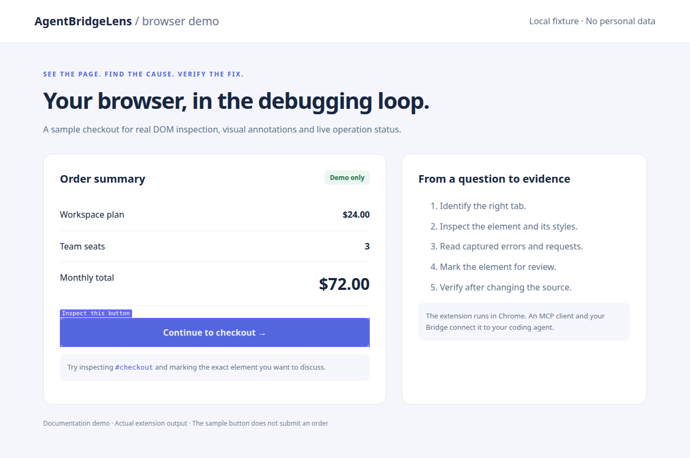
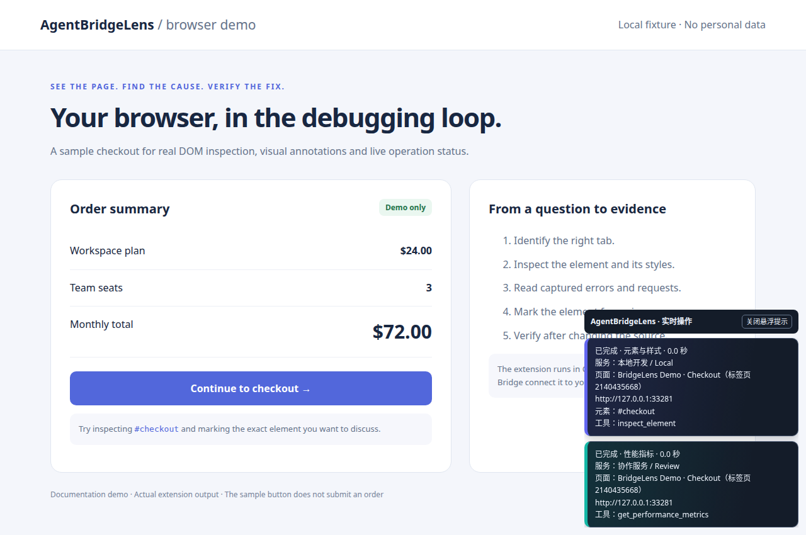
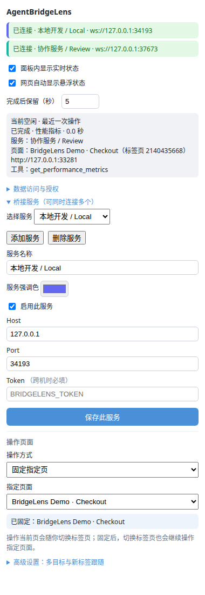

<div align="center">


# AgentBridgeLens

**让 AI 看见你的真实 Chrome，把页面问题一路查到代码。**

保留当前登录态和页面现场，通过 MCP 截图、检查元素、读取报错与请求，再回到浏览器验证修复。

**简体中文** · [English](README.en.md)

[](https://github.com/Erhao/AgentBridgeLens/releases/latest)
[](https://www.npmjs.com/package/agentbridgelens)
[](packages/extension/src/manifest.json)
[](packages/bridge/README.md)

[📦 下载扩展](https://github.com/Erhao/AgentBridgeLens/releases/latest) · [🚀 快速开始](#-快速开始) · [🧰 能力清单](#-mcp-能力清单) · [📖 使用指南](docs/USAGE.md)

</div>



*真实扩展截图：AI 使用的标注能力可以把要检查的按钮直接圈在页面上。截图来自独立浏览器中的本地演示页，无个人浏览数据。*

## ✨ 为什么用 AgentBridgeLens

- **保留问题现场。** 直接连接你已打开、已登录的 Chrome，继续检查当前页面、交互状态和数据，无需重新登录复现。
- **从现象走到源码。** 联合截图、DOM、计算样式、控制台与网络记录取证；React/Vue 开发构建可追踪组件来源，有可用 source map 时可还原错误堆栈。
- **让你看清 AI 在做什么。** 页面自动显示操作卡片，标出工具、目标页、Bridge、数据类别、结果和耗时；面板和网页提示可独立开关。
- **切标签也能继续查。** 可固定目标页，显式指定 `tabId` 操作多个页面，包括读取后台页 DOM、采集网络和截图。
- **一个 Chrome，连接多个 Bridge。** 本地开发机、笔记本或远端服务可同时连接，各自重连、用不同颜色识别操作来源。
- **接入现有 MCP 工作流。** 支持 stdio 和 Streamable HTTP；Bridge 可用 `npx` 启动，扩展可直接下载预编译包。

适合前端排错、已登录业务页面诊断、跨页面流程检查，以及修改源码后的人工协作验证。需要访问对应源码的修复由 AI 编码客户端完成，扩展负责提供浏览器证据和网页操作能力。

## 👀 先看看怎么用

### 描述问题，直接检查真实页面

你可以直接对 AI 说：

> 当前页面的提交按钮点了没反应。先确认页面，检查按钮和近期报错，必要时开启网络采集让我复现，再结合源码定位问题。修完后重新验证。

一次典型排查会这样进行：

```text
确认目标页 → 截图 / 检查按钮 → 查看报错和请求
           → 追踪组件或错误来源 → 修改源码 → 回到页面验证
```

| 你想做什么 | 可以这样说 |
| --- | --- |
| 看布局和样式 | “右侧卡片被裁切了，检查宽度和 overflow，把相关元素框出来。” |
| 查接口异常 | “列表一直为空。先开网络采集，我刷新后你看看接口状态和耗时。” |
| 查源码来源 | “这个按钮由哪个 React/Vue 组件渲染？颜色来自哪个 CSS 规则？” |
| 复现多步问题 | “开始录制，我操作一遍；停下后，修复并回放这段操作。” |
| 跟踪两个页面 | “固定这两个页面，用各自的 tabId 查看原页面和新打开页面的状态。” |
| 共同确认方案 | “在扩展侧边栏给我两个选项，我选完再继续。” |

### 操作过程在页面上可见



每次调用独立成卡，按开始顺序堆叠；执行中持续显示，结束后默认保留 **2 秒**，可调整为 **0～300 秒**。不同 Bridge 可自定义强调色，修改颜色不会中断连接。工具截图会自动隐藏这些状态卡片。

*截图为脚本向两个本地演示 Bridge 发出工具请求后的真实扩展显示；为方便阅读，演示配置延长了完成提示时间。*

### 连接与目标页都能自己掌握

<p align="center">
  
</p>

弹窗和侧边栏都能管理连接、授权和操作页面。默认“操作当前页”，也可选择“固定指定页”；多目标与新标签跟随策略在“高级设置”中。

> 扩展界面目前以中文为主；英文 README 提供对应操作说明。截图中的端口为演示临时端口，实际默认 WebSocket 端口为 `19222`。

## 🚀 快速开始

需要 **Chrome、支持 MCP 的 AI 客户端、Node.js 18+（运行 Bridge）**。扩展安装本身不需要 Node.js；可选更新工具需要 Node.js 20+ 和系统 `curl`。

### 1. 下载并加载扩展

1. 从 [GitHub Releases](https://github.com/Erhao/AgentBridgeLens/releases/latest) 下载 `agentbridgelens-extension-X.Y.Z.zip`。
2. 解压到一个准备长期保留的目录。
3. 打开 `chrome://extensions/`，开启右上角的“开发者模式”。
4. 点击“加载已解压的扩展程序”，选择包含 `manifest.json` 的解压目录。

### 2. 给 AI 客户端配置 MCP

以 Claude Code 为例，注册到用户作用域后可在不同项目中使用：

```bash
claude mcp add -s user bridgelens -- npx -y agentbridgelens
```

其他支持 MCP stdio 的客户端，可按其配置格式填写以下服务定义：

```json
{
  "mcpServers": {
    "bridgelens": {
      "command": "npx",
      "args": ["-y", "agentbridgelens"]
    }
  }
}
```

保存后重新启动或重新加载客户端的 MCP 连接。客户端会自动启动 Bridge，无需另开终端运行。

### 3. 授权并确认连接

1. 点击 Chrome 工具栏的 AgentBridgeLens 图标。
2. 展开“数据访问与授权”，阅读说明，勾选同意并点击“应用授权设置”。**首次安装必须完成这一步才会连接。**
3. 在“桥接服务”中确认 Host 为 `127.0.0.1`、Port 为 `19222`，服务已启用；修改后点击“保存此服务”。
4. 顶部显示“已连接”后，打开目标 HTTP/HTTPS 网页。安装、更新或重载前已打开的普通网页会自动恢复脚本，无需逐个刷新；恢复失败时才提示刷新。
5. 对 AI 说：**“用 bridgelens 确认当前页面并截一张图。”**

## 🔌 多标签页、多 Bridge 与远程使用

### 固定目标，避免切换页面时操作错位

在“操作页面”里选择“固定指定页”，再选目标页面。AI 也可以用 `list_tabs` 找到页面，再通过 `set_target_tab` 固定。

页面工具的目标优先级为：**显式 `tabId` → 固定目标 → 当前激活页**。多个固定目标时，优先取当前记录的最近激活页（若它在目标集合中），否则取最后加入的目标。固定目标随浏览器会话保存，浏览器重启后清空。

高级设置支持多个固定目标，并可对每个目标启用“跟随新标签”，把它打开的页面加入目标集合。连续排查和多客户端协作建议始终传入明确的 `tabId`。

### 一个 Chrome 同时连接多个服务

在“桥接服务”中点击“添加服务”，分别填写名称、Host、Port、Token，启用并保存。每个服务独立连接和重连，请求结果只返回发起请求的服务。

**所有服务共享浏览器、目标设置、录制、调试采集和叠加层状态**，不是隔离的浏览器环境。同机运行多个 Bridge 时，为每个实例设置不同的 `BRIDGELENS_PORT`，并在扩展里填写对应端口。

### Bridge 在另一台机器上

优先通过 SSH 转发，让 Bridge 保持默认的本机监听地址。在运行 Chrome 的机器执行：

```bash
ssh -N -L 19222:127.0.0.1:19222 user@bridge-host
```

扩展仍连接 `127.0.0.1:19222`。若需要直接跨机连接，则在 AI 客户端的 MCP 服务配置中加入：

```json
"env": {
  "BRIDGELENS_HOST": "0.0.0.0",
  "BRIDGELENS_TOKEN": "replace-with-a-long-random-secret"
}
```

扩展填写 Bridge 的可达 IP、对应端口和相同 Token。内置监听为明文 WS/HTTP；跨不可信网络时使用 SSH 隧道或 TLS 反向代理。

### 通过 URL 连接 MCP

适合支持 **Streamable HTTP** 的远程客户端。在 Bridge 所在机器独立启动：

```bash
BRIDGELENS_TRANSPORT=http \
BRIDGELENS_HTTP_HOST=0.0.0.0 \
BRIDGELENS_HTTP_TOKEN='replace-with-a-long-random-secret' \
npx -y agentbridgelens
```

客户端连接 `http://<bridge-host>:19223/mcp`，附带 `Authorization: Bearer <密钥>`。**`19223` 是 MCP HTTP 端口，`19222` 是扩展 WebSocket 端口。** 若 Chrome 也在另一台机器，还需单独设置 WebSocket 的监听地址和 Token，或转发 WebSocket 端口。

HTTP 使用无状态 Streamable HTTP，支持 POST 的 SSE 响应；不提供旧版 HTTP+SSE、会话恢复或独立 GET 事件流。浏览器中的 MCP 客户端还需配置 Origin 白名单。完整环境变量、鉴权和限制见 [Bridge 文档](packages/bridge/README.md)。

## 实时动作查看

开启「网页自动显示悬浮状态」后，提示只会显示在目标页面所属的 Chrome 窗口内；在该窗口切换标签页仍可查看，其他窗口不会显示这个动作。多个窗口并行操作时，各窗口分别显示自己的动作。运行中的目标标签页拖到另一窗口时，提示会跟随；纯浏览器管理动作只保留在插件面板日志中。

每个动作会独立显示卡片，按时间堆叠，最新的位于最下方。执行中持续显示；完成后按照「完成后保留（秒）」倒计时，默认 2 秒，卡片底部进度条走完后自动消失。

鼠标移入卡片（或键盘焦点进入）会将它固定：停止倒计时、隐藏进度条，并显示「已固定」。移开鼠标后也不会继续计时，直到点击这张卡片的「×」。关闭单张卡片不会关闭实时显示开关，其他卡片仍独立计时。顶部「关闭自动提示」会关闭网页自动提示，可在插件里重新开启。

固定卡片在当前页面保留，截图期间会临时隐藏，截图后恢复；刷新页面或关闭自动提示会清除固定状态。

## 🧰 MCP 能力清单

以下以当前 [MCP 注册代码](packages/bridge/src/mcp-server.ts) 为准。你无需记住工具名，描述目标即可。

| 能力 | 工具 |
| --- | --- |
| 标签页发现与固定 | `list_tabs` · `set_target_tab` · `get_target_tab` · `clear_target_tab` |
| 页面信息与截图 | `get_page_info` · `capture_screenshot`（视口或指定元素，支持后台页） |
| 结构、样式与无障碍 | `get_dom_snapshot` · `inspect_element` · `get_accessibility_tree` |
| 页面脚本与性能 | `execute_js` · `get_performance_metrics` |
| 组件、CSS 与错误来源 | `trace_element_to_source` · `trace_style_to_source` · `trace_error_to_source` |
| 控制台与轻量网络记录 | `get_console_logs` · `get_errors` · `get_network_requests` |
| CDP 网络采集 | `start_cdp_network` · `get_cdp_network` · `stop_cdp_network` |
| 可视化标注与布局检查 | `mark_elements` · `visualize_layout` · `show_responsive_frame` · `clear_overlays` |
| 交互录制与回放 | `start_recording` · `stop_recording` · `replay_actions` |
| 按需显示页面 HUD | `show_hud` · `update_hud` · `hide_hud` |
| 侧边栏交互确认 | `request_user_confirmation`（需打开扩展侧边栏） |

### 使用时了解这些边界

- **日志和请求有采集时间范围。** 轻量网络只记录扩展注入后捕获的 Fetch/XHR；查初始加载过程，请先启动 CDP 采集，再刷新或复现，最后停止采集。不能补回启动采集前的历史请求。
- **源码追踪依赖构建信息。** 组件文件和行号通常需要 React/Vue 开发构建；错误还原需要可访问的 bundle 和 source map，Bridge 必须能访问其 URL。
- **CDP 会有调试提示。** 页面脚本执行、后台截图、CDP 网络采集可能显示 Chrome 调试横幅，并可能与 DevTools 或其他调试器冲突。
- **响应式框是辅助标注。** `show_responsive_frame` 叠加目标宽度并查找过宽元素，不会真正改变视口或模拟手机设备。
- **部分页面受 Chrome 限制。** `chrome://`、扩展商店等页面不能像普通网页一样操作；录制/回放覆盖点击、输入、滚动，不保证复杂跨页面流程的完整自动化。
- **状态卡片只显示操作元信息。** 不显示脚本正文、请求正文或返回数据；状态保存在扩展后台内存中，后台重启后清空。

## 🔒 数据与授权

扩展连接的是你指定的 Bridge。授权后，AI 客户端可以通过它访问网页内容、截图、标签信息和调试数据，并执行网页脚本；录制还可能包含输入内容。数据经 Bridge 传给 AI 客户端，**可能离开本机**，具体取决于你的部署和客户端。

只连接可信服务。撤销“数据访问与授权”会断开所有 Bridge；关闭状态提示仅影响显示，不会停止工具执行。完整说明见随扩展提供的 [隐私政策](packages/extension/public/privacy.html)。

## 🔄 保留配置的扩展更新

从 [Releases](https://github.com/Erhao/AgentBridgeLens/releases/latest) 下载一次 `agentbridgelens-updater.zip`，保留解压后的工具目录。需要 Node.js 20+ 和系统 `curl`，无需安装 npm 依赖。

| 系统 | 启动方式 |
| --- | --- |
| Windows | 双击 `update-extension.cmd` |
| macOS | 双击 `update-extension.command`，或运行 `sh update-extension.command` |
| Linux | 运行 `sh update-extension.sh` |

首次填写 Chrome 扩展详情中显示的**原加载目录**；之后会记住目录，下载最新正式版、校验 SHA256 并保留上一版。更新后在 `chrome://extensions/` 点击原插件的“重新加载”；普通网页的脚本和实时提示会自动恢复，不会刷新页面或丢失未保存输入。

**保留原目录和原插件身份，不要卸载后重新导入。** 这样可保留 Chrome 中的桥接配置和显示偏好；工具不负责换电脑或重装后的配置迁移。

```bash
node update-extension.mjs --dir "原扩展目录"  # 首次指定，后续可省略
node update-extension.mjs --check            # 仅检查版本
node update-extension.mjs --rollback         # 恢复上一版
node update-extension.mjs --proxy http://127.0.0.1:7897
```

支持环境变量代理、macOS 系统手动代理和保存指定代理地址。临时网络错误默认最多尝试 5 次，按 1、2、4、8 秒逐步延长间隔并显示进度；可用 `--retries 6` 自定义额外重试次数。持续 403 会区分代理拒绝与站点拒绝；API 403/429 时会尝试公开发行页，仍沿用当前代理并校验官方包。更多参数见 [更新工具说明](scripts/update/README.txt)。

## 🛠️ 从源码运行

仓库使用 **pnpm 10.33.3**。自动发布工具链使用 Node.js 24，开发时建议与之保持一致。

```bash
git clone https://github.com/Erhao/AgentBridgeLens.git
cd AgentBridgeLens
pnpm install --frozen-lockfile
pnpm build
```

在 Chrome 加载 `packages/extension/dist/`；MCP 服务改为指向本地构建：

```json
{
  "mcpServers": {
    "bridgelens": {
      "command": "node",
      "args": ["/absolute/path/AgentBridgeLens/packages/bridge/dist/index.js"]
    }
  }
}
```

```bash
pnpm dev:bridge      # Bridge 监听构建并重启
pnpm dev:extension   # 扩展监听构建，之后需在 Chrome 重新加载
pnpm zip             # 构建并打包扩展
pnpm typecheck
pnpm --dir packages/bridge test
pnpm --dir packages/extension test
pnpm test:release
pnpm test:updater
```

```text
AI 客户端 ⇄ MCP（stdio / Streamable HTTP）⇄ Bridge ⇄ WebSocket ⇄ Chrome 扩展 ⇄ 网页
```

```text
packages/bridge/       MCP 工具、传输、WebSocket 中继、source map 错误还原
packages/extension/    Manifest V3 后台、页面检查、弹窗与侧边栏
skills/agentbridgelens/ 可选的 AI 使用指导，不代替扩展或 MCP 服务
scripts/update/       固定目录更新与回滚工具
scripts/readme/       本地演示页与真实扩展截图生成脚本
docs/                 使用、架构、验证与发布文档
```

README 截图可在 `pnpm build` 后通过独立安装的 Playwright 重拍：

```bash
ABL_PLAYWRIGHT_MODULE=/path/to/playwright/index.mjs node scripts/readme/screenshots.mjs
```

可用 `ABL_CHROMIUM_EXECUTABLE` 指定支持加载扩展的 Chromium。脚本使用独立浏览器配置和本地演示服务，不读取个人 Chrome 配置。

## 📚 文档与排障

| 文档 | 内容 |
| --- | --- |
| [用户指南](docs/USAGE.md) | 更多场景与自然语言示例 |
| [Bridge 配置](packages/bridge/README.md) | 环境变量、远程传输、鉴权与限制 |
| [架构说明](docs/ARCHITECTURE.md) | 组件职责和通信链路 |
| [Skill 快速上手](docs/SKILL-QUICKSTART.md) | 可选的 AI 引导流程 |
| [验证清单](docs/VERIFICATION.md) | 功能验证与操作检查 |
| [发布流程](docs/RELEASING.md) | 自动版本、构建和发布 |

遇到“未连接”，先确认**授权已应用、MCP 客户端已启动 Bridge、两端 WebSocket 地址/端口/Token 一致**。如果显示已连接但无法操作，确认目标是普通网页且扩展拥有该站点的访问权限。新版会自动恢复失效的网页脚本；若仍出现恢复失败提示，再刷新该页面重试。需要进一步排查时，从 `chrome://extensions/` 打开扩展的 Service Worker 控制台查看日志，或 [提交 Issue](https://github.com/Erhao/AgentBridgeLens/issues)。
