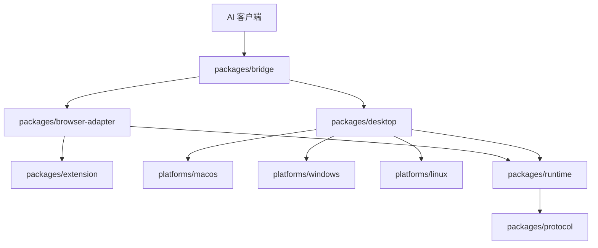

# AgentBridgeLens 架构

AgentBridgeLens 采用单仓库、多组件结构。`packages/bridge` 是唯一 MCP 服务入口，浏览器和本机桌面能力共存；Swift、C#、Python 原生执行端通过适配层接入。

- [统一架构与模块边界](architecture/OVERVIEW.md)
- [迁移记录与兼容性](architecture/MIGRATION.md)
- [浏览器调用链](architecture/BROWSER.md)
- [桌面协议](protocol/DESKTOP.md)
- [macOS](platforms/MACOS.md)、[Windows](WINDOWS-DESKTOP.md)、[Linux](LINUX-DESKTOP.md)
- [制品发布](releasing/DESKTOP.md)

